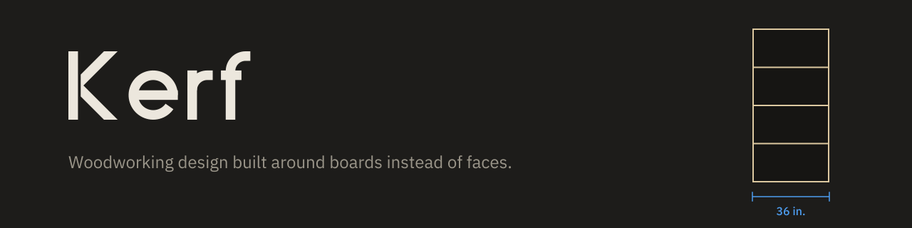

# Kerf

Free, open-source woodworking design tool built around boards instead of faces.

Status: prototype, milestone M0 (foundations). No features yet.

- Planning spec: [docs/spec/](docs/spec/)
- Decision records: [docs/adr/](docs/adr/)
- How Kerf works, in plain language: [docs/HOW_KERF_WORKS.md](docs/HOW_KERF_WORKS.md)
- Code quality standard: [docs/CODE_QUALITY.md](docs/CODE_QUALITY.md)
- Testing standards: [docs/testing/](docs/testing/)
- Agent rules: [CLAUDE.md](CLAUDE.md)
- Brand: [docs/brand/](docs/brand/)

License: GPL-3.0 (see [LICENSE](LICENSE)).
